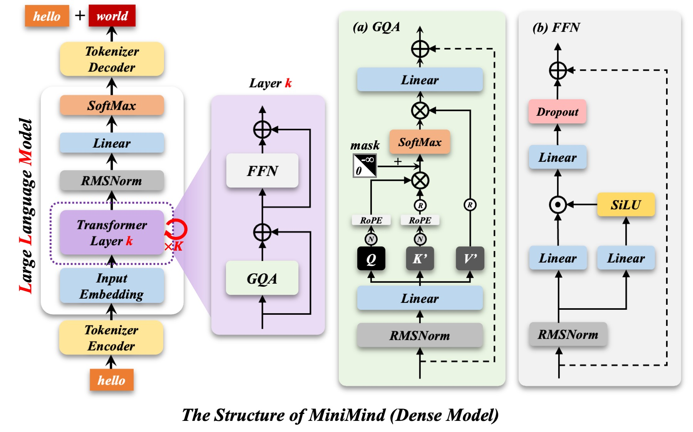

# 数据流：从 `hello` 到 `hello world`

以 MiniMind dense（hidden 768、8 层、8 头、kv 头 4、词表 6400）为例。



## 1. 整体一次前向

```text
"hello"
  → Tokenizer Encoder      "hello" → [token id]                        整数
  → Input Embedding        每个 id 查表 → 768 维向量
  → Transformer Layer ×K   每层 = Attention 子层 + FFN 子层（各带残差）
  → RMSNorm                最后一次归一化
  → Linear (lm_head)       768 → 6400，每个词表项一个分数（logits）
  → SoftMax                变成概率
  → Tokenizer Decoder      取概率最大的 id → 文本 "world"
```

设输入 5 个 token，进网络的张量是 `[5, 768]`（实际还有 batch 维，先忽略）。

**残差流的宽度永远是 768。** 这是看懂所有形状的锚点：每个子层进去是 768，出来必须还是 768，才能加回主干（`h = x + sublayer(x)`）。

## 2. Layer k 内部

```text
x [5, 768]
├─ input_layernorm ──→ Attention ──→ ⊕  h [5, 768]
└────────────────────────────────────↑ 残差
h [5, 768]
├─ post_attention_layernorm ──→ FFN ──→ ⊕  h' [5, 768]
└────────────────────────────────────↑ 残差
```

两个子层的分工：**Attention 让 token 之间交换信息**（纵向、跨位置），**FFN 对每个 token 单独加工**（横向、不跨位置）。

## 3. (a) GQA：注意力内部

```text
x [5, 768]
 ├─ q_proj 768→768 ─→ Q [5, 8, 96]   q_norm(96) ─→ RoPE ─┐
 ├─ k_proj 768→384 ─→ K [5, 4, 96]   k_norm(96) ─→ RoPE ─┤
 └─ v_proj 768→384 ─→ V [5, 4, 96]                        │
                                                          ↓
        K,V 复制 2 份（4→8 组）← repeat_kv ────→ scores = Q·Kᵀ/√96  [5,8,5,5]
                                                          ↓
                                    mask 上三角置 -∞（只能看左边）
                                                          ↓
                                        softmax → 权重 × V → [5, 8, 96]
                                                          ↓
                                    拼回 [5, 768] ─→ o_proj 768→768
                                                          ↓
                                                  ⊕ 加回残差
```

四个投影各管什么：

| 名字 | 形状 | 作用 |
|---|---|---|
| `q_proj` | 768×768 | 变成「我在找什么」 |
| `k_proj` | 768×384 | 变成「我是什么、可被谁找到」，只 4 个头 |
| `v_proj` | 768×384 | 变成「被找到后要交出的内容」，只 4 个头 |
| `o_proj` | 768×768 | 8 个头的输出拼回 768 后，**再做一次跨头混合** |

- **分头不加参数**：8 头 × (768→96) 合起来正好是 768×768。
- **GQA 省在 K/V**：8 个 Q 头共享 4 组 K/V，`k_proj`/`v_proj` 只要 384 宽；KV cache 也直接减半。
- **q_norm / k_norm 就是 RMSNorm**，但只作用在每个头的 96 维上（所以各 96 个参数）。目的是把 Q、K 的数值量级拉齐，否则点积差别几十倍、softmax 一边倒。
- **RoPE 不占参数**，它按位置旋转 Q、K，是固定公式。

## 4. (b) FFN：逐 token 加工

```text
x [5, 768]
 ├─ gate_proj 768→2432 ─→ SiLU ─┐
 └─ up_proj   768→2432 ────────→ ⊗ ─→ down_proj 2432→768 ─→ ⊕
```

即 `down_proj( SiLU(gate_proj(x)) * up_proj(x) )`，这就是 SwiGLU。

三个矩阵都是 2432 宽（$2432 \approx \frac{8}{3}\times768$，取 64 的倍数）。**FFN 参数是 attention 的 3.2 倍**（560万 vs 177万），这是 Transformer 的常态：一半以上的参数都在 FFN 里。

为什么两条分支再相乘？可以理解成 `gate` 通道算出一个 0~1 附近的「闸门」，去调节 `up` 通道里的信息该怎么放行。纯乘法结构的表达力比单条 `ReLU(Wx)` 强，同参数下效果更好。

## 5. 训练时的最后一层

`lm_head` 把 768 映射到 6400 个词，得到 logits；与「下一个 token 的正确答案」算交叉熵。

MiniMind 里 `lm_head` 与 `embed_tokens` **共享同一张权重表**（`tie_word_embeddings=True`），省下 4.9M 参数——这也解释了为什么 64M 的账里词表只算了一次。

初始 loss ≈ $\ln 6400 \approx 8.76$，因为模型此时对所有词一视同仁。

## 6. 一句话串起来

**Embedding 查表 → 8 层（每层：token 之间用注意力交换信息、每个 token 用 FFN 单独加工，两次都靠残差保住主干）→ 归一化 → 映射回词表 → 取 softmax。**
