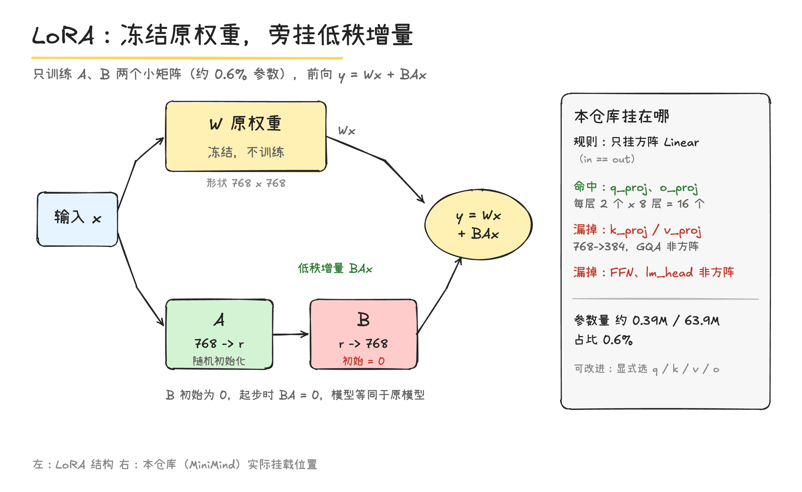

# LoRA：冻结原权重，旁挂低秩增量

full_sft 权重 → 冻结全部 base → 旁挂低秩增量 `ΔW = BA`（r=16）→ 只训 A、B（约 0.39M / 0.6%）



代码：`third_party/minimind/model/model_lora.py`、`third_party/minimind/trainer/train_lora.py`。


## 1. 结构：ΔW = BA

| 记号 | 形状 | 初始化 | 说明 |
|---|---|---|---|
| `W` | `[out, in]` | 原权重 | **冻结** |
| `A` | `[r, in]` | 高斯 `N(0, 0.02)` | 低秩矩阵 |
| `B` | `[out, r]` | **全 0** | 低秩矩阵 |
| `r` | — | 16（本仓库） | rank，控制低秩大小；常见 4/8/16/32 |

- 前向：`y = Wx + B(A(x))`，即 `W + ΔW`，其中 `ΔW = B.weight @ A.weight`（形状 `[out,in]`，与 `W` 对齐）。
- **为什么 B=0、A 随机**：`B=0 ⇒ ΔW = BA = 0`，起步等价于原模型，不破坏 base；但**不能两个都 0**（梯度全 0 学不动）。`B=0` 时 `∂L/∂B ∝ A(x) ≠ 0`，所以第一步先更新 `B`，之后 `A` 才有梯度。
- 参数量：每个 LoRA = `r·in + out·r`；对 768 的方阵、r=16 即 `2 × 768 × 16 = 24576`。

## 2. 本仓库挂在哪 

`apply_lora` 的筛子（`model_lora.py:23`）：

```python
if isinstance(module, nn.Linear) and module.in_features == module.out_features:
    # 挂 LoRA
```

**只挂「方阵」Linear**，于是：

| | 是否挂 | 原因 |
|---|---|---|
| `q_proj`(768→768)、`o_proj`(768→768) | ✅ 命中 | 方阵，`in == out` |
| `k_proj` / `v_proj`(768→384) | ❌ 漏掉 | GQA（kv_heads=4）砍半，非方阵 |
| FFN(2432)、`lm_head`(→6400) | ❌ 漏掉 | 非方阵 |

- 命中：每层 2 个 × 8 层 = **16 个 LoRA**，参数 `16 × 24576 = 393,216 ≈ 0.39M ≈ 63.9M 的 0.6%`。


## 3. LoRA 和 full SFT 差在哪

**数据和损失完全一样，差别只在「动哪些参数」。**

| 维度 | full SFT（`train_full_sft.py`） | LoRA（`train_lora.py`） |
|---|---|---|
| 数据管道 | `SFTDataset` | 同一个 `SFTDataset` |
| loss / mask | assistant-only + shift | 完全一样 |
| 可训练参数 | 全部 ~63.9M | 只 LoRA ~0.39M（0.6%） |
| base 权重 | 会被改 | **冻结不动** |
| 起点 | `from_weight=pretrain` | `from_weight=full_sft` |
| lr / epochs | 1e-5 / 1 | 1e-4 / 10 |
| 存什么 | 整模 `full_sft_768.pth`（~137MB） | 只 LoRA `lora_medical_768.pth`（<1MB） |


## 4. `model_lora.py`：五个函数

| 函数 | 行 | 干什么 | 关键点 |
|---|---|---|---|
| `LoRA`(类) | `:6-18` | A、B 两个 Linear，`forward=B(A(x))` | A 高斯、B 零 |
| `apply_lora` | `:21-32` | 给方阵 Linear 挂 LoRA | `setattr(module,"lora",…)` 让参数名带 `.lora.`；猴补丁实例 `forward = layer1(x)+layer2(x)`；默认参数 `layer1/layer2` 防闭包晚绑定 |
| `load_lora` | `:35-42` | 读权重灌回 | 剥 DDP `module.` 前缀（`k[7:]`）；须先 `apply_lora` |
| `save_lora` | `:45-53` | 只存 LoRA | 解 `_orig_mod`；cpu + half；键 `{name}.lora.{A/B}.weight` |
| `merge_lora` | `:56-65` | 合并回整模 | `W += B@A`，丢掉 `.lora.`；**不可逆**，该 base 被此 LoRA 污染 |


## 5. `train_lora.py`：训练脚本

循环和 SFT 几乎一致（同一 `SFTDataset`、同一 mask、同一余弦 lr），真正的不同只有 4 处：

1. `apply_lora` 后**冻结非 lora 参数**、收集 `lora_params`（`train_lora.py:131-138`）；
2. 优化器 / 梯度裁剪**只喂 `lora_params`**（`:43`、`:144`）；
3. 保存只存 LoRA（`save_lora`，`:59-63`）；
4. 默认 `lr=1e-4`、`epochs=10`、`from_weight='full_sft'`（`:76`、`:74`、`:89`）。

