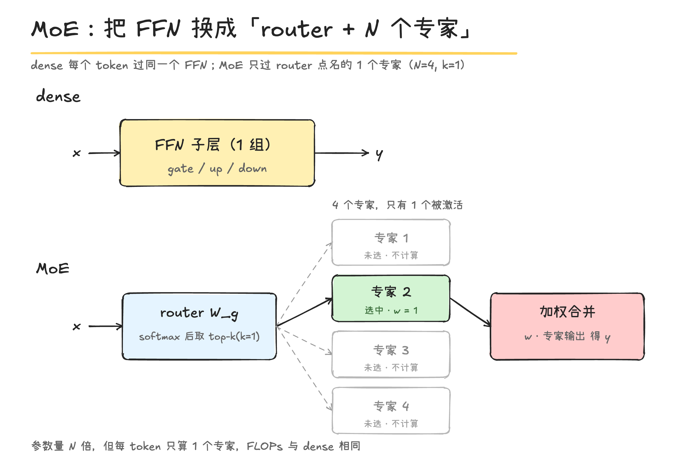
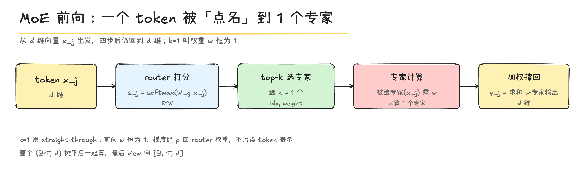

# MoE：稀疏激活——参数放大，算力不放大

以 MiniMind dense 配置为准：$d=768$、$L=8$、专家数 $N=4$、每 token 激活 $k=1$、专家中间维 $m=2432$。本项目 `configs/*.yaml` 里 `use_moe: 0`，所以下面是**读代码得到的设计对照**，不是训练实测。

## 1. 为什么要 MoE：把参数量和计算量解耦

dense 模型每个 token 都过同一个 FFN，于是

$$
\text{参数量}\;\propto\;3dm,\qquad \text{每 token FLOPs}\;\propto\;2\cdot 3dm
$$

两者被同一个 $3dm$ 绑死：想加容量，就必须加算力。

MoE 把 FFN 换成 $N$ 个专家、每个 token 只激活其中 $k$ 个：

$$
\text{总参数}\;\propto\;N\cdot 3dm,\qquad \text{每 token FLOPs}\;\propto\;2k\cdot 3dm
$$

取 $k\ll N$，**参数按 $N$ 放大，算力只按 $k$ 走**——这就是「大而不贵」。

## 2. 结构：一行开关决定子层

`MiniMindBlock`（`third_party/minimind/model/model_minimind.py`）：

```python
self.mlp = FeedForward(config) if not config.use_moe else MOEFeedForward(config)
```



| | dense `FeedForward` | `MOEFeedForward` |
|---|---|---|
| 结构 | 1 组 `gate/up/down_proj` | `gate`(router) + **N 个** `FeedForward` |
| router | 无 | `nn.Linear(d, N, bias=False)` |
| 每 token 计算 | 1 个 FFN | $k$ 个 FFN（本项目 $k=1$） |
| 本项目默认 | — | $N=4,\ k=1,\ m=2432,\ \text{norm\_topk\_prob}=\text{True},\ \alpha=5\times10^{-4}$ |

每个专家和 dense 的 FFN **一样大**（$m=2432$），所以 $N=4$ 个专家 = FFN 参数 $\times4$。

## 3. 参数账

沿用 `params.md` 的每层结构，只把 FFN 那段换掉。

**dense 闭式**

$$
N_{\text{dense}}=Vd+L\big(3d^2+2d_h+2d+3dm\big)+d=63{,}912{,}192
$$

**MoE 闭式**（把 $3dm$ 换成 $N\cdot3dm$，再加 router $dN$）

$$
N_{\text{MoE}}=Vd+L\big(3d^2+2d_h+2d+N\cdot3dm+dN\big)+d
$$

代入 $N=4$：

| 部位 | dense | MoE（$N=4$） |
|---|---|---|
| 每层 FFN | $3dm=5{,}603{,}328$ | $4\times5{,}603{,}328+768\times4=22{,}416{,}384$ |
| 每层合计 | $7{,}374{,}528$ | $24{,}187{,}584$ |
| 8 层 | $58{,}996{,}224$ | $193{,}500{,}672$ |
| **总参数** | $\mathbf{63{,}912{,}192}$ | $\mathbf{198{,}416{,}640}$ |

$$
\frac{N_{\text{MoE}}}{N_{\text{dense}}}=\frac{198{,}416{,}640}{63{,}912{,}192}\approx 3.10
$$

但**每 token 只激活 1 个专家**：

$$
N_{\text{activated}}=N_{\text{dense}}\approx 63.9\text{M},\qquad \text{每 token FLOPs 与 dense 相同}
$$

一句话：**总参 $198\text{M}$，激活 $64\text{M}$，FLOPs 不变。**

## 4. 前向：一个 token 的四个动作（`model_minimind.py:148-181`）

把 $X\in\mathbb{R}^{B\times T\times d}$ 摊平成 $\mathbb{R}^{(BT)\times d}$，记第 $j$ 行为 $x_j\in\mathbb{R}^d$。

**(1) 打分**

$$
s_j=\operatorname{softmax}\!\big(W_g\,x_j\big)\in\mathbb{R}^{N},\qquad W_g\in\mathbb{R}^{N\times d}
$$

**(2) 选 top-k**

$$
\mathcal{E}(j)=\operatorname{topk}(s_j,\,k),\qquad w_{j,i}=s_{j,i}\quad(i\in\mathcal{E}(j))
$$

**(3) 逐专家 gather 计算、scatter 加权**

$$
y_j=\sum_{i\in\mathcal{E}(j)} w_{j,i}\;\mathrm{FFN}_i(x_j)
$$

**(4) `view` 回 $[B,T,d]$。**

形状链：



### 3.1 关键：$k=1$ 的 straight-through

$k=1$ 时若把权重「归一化」就是 $s/s=1$，但 $\dfrac{\partial\,(s/s)}{\partial W_g}=0$，**router 永远学不动**。MiniMind 用 stop-gradient 造了一个「前向恒为 1、反向有梯度」的数：

### 3.2 空专家的梯度图保护

某个专家这一批没被任何 token 选中 → 它的输出不进计算图 → 参数拿不到梯度，DDP/优化器会报错。MiniMind 用零系数把它挂回图：

$$
y_{0}\;\mathrel{+}=\;0\cdot\!\!\sum_{\theta\in\mathrm{FFN}_i}\!\theta
$$

数值上加 0 不影响结果，只为让这个专家「有一条梯度路径」。


## 5. 负载均衡

MoE 要防**专家塌缩**：router 越偏爱某专家，它练得越好、越被偏爱。用负载均衡损失压住（`model_minimind.py:236`）：

$$
f_i=\frac1T\sum_{j=1}^{T}\mathbb{1}\!\left[i\in\mathcal{E}(j)\right],\qquad
P_i=\frac1T\sum_{j=1}^{T}s_{j,i}
$$

$$
\mathcal{L}_{\text{aux}}=\alpha\,N\sum_{i=1}^{N}f_i\,P_i,\qquad \alpha=5\times10^{-4}
$$

本项目 dense，`aux_loss` 恒为 0；完整训练机制留到训练篇。