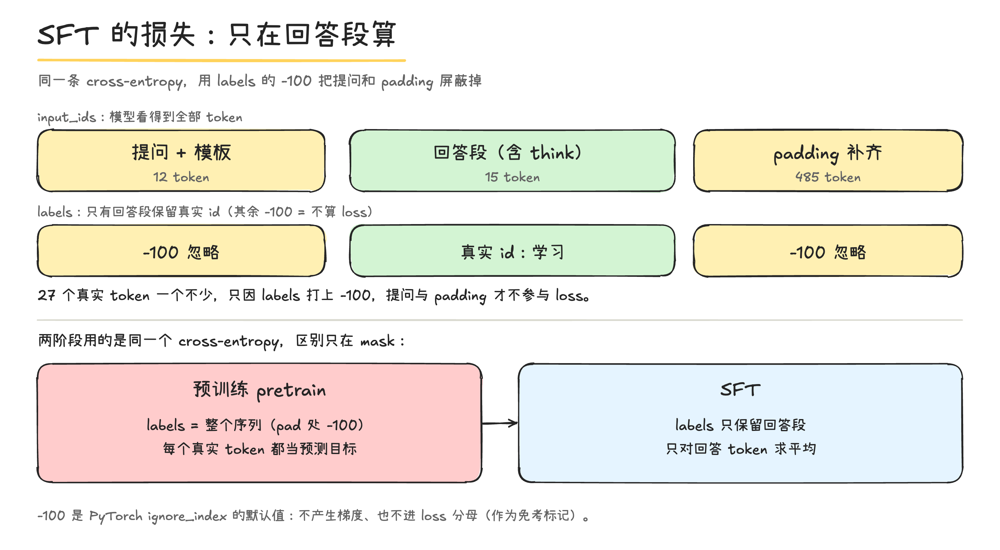

# SFT：把「会接龙」变成「会回答」

jsonl 对话 → 套 `<|im_start|>…<|im_end|>` 模板 → 分词、pad 到定长 → `labels` 只保留回答段 → 同一个 cross-entropy → `out/full_sft_768.pth`



## 1. 两阶段的分工

| | 预训练 pretrain | 监督微调 SFT |
|---|---|---|
| 数据 | 无标注长文本（1,270,240 条） | 多轮对话（`sft_t2t_mini.jsonl`，1.66GB） |
| 目标 | $P(\text{token}\mid\text{前文})$，对**整段**求平均 | $P(\text{answer}\mid\text{prompt})$，只对**回答段**求平均 |
| 学到 | 语言 + 世界知识（会接龙） | 对话格式 + 听指令（会回答） |
| 起点 | 随机初始化 | `out/pretrain_768.pth` |
| lr | $5\times10^{-4}$ | $1\times10^{-5}$ |
| 时长 | 1h49m（8GB 实测） | 待跑 |

- SFT **不主要教新知识**：数据量小、epoch 少（1 轮）、lr 小，作用是把预训练学到的能力「对齐」成对话格式。
- 两阶段**用的是同一个损失函数**（同一个 `cross_entropy`、同一个 shift），区别只在「哪些位置算 loss」——见 §4。

## 2. 数据长什么样

一行一条多轮对话（`dataset/sft_t2t_mini.jsonl`，约 1.66GB）：

```json
{"conversations":[
  {"role":"user","content":"…"},
  {"role":"assistant","content":"…","reasoning_content":"…"},
  {"role":"user","content":"…"},
  {"role":"assistant","content":"…","reasoning_content":"…"}
]}
```

- `role` 有 user / assistant / system（也可能带 tools / tool_calls）。
- assistant 的 `reasoning_content` 是 `<think>…</think>` 里的思考；`content` 是正式回答。
- **多轮天然支持**：一条样本里有多少个 assistant 段，就有多少段被学（§4 的 549-token 样本有 6 段）。
- 用 `datasets.load_dataset('json')` 读，`features` 在 `lm_dataset.py:66` 写死了列名（含工具字段）；jsonl 的列要对齐这份 schema，否则解析报错。

## 3. 数据管道：一行 json → 两个等长张量

```text
一行 json（多轮对话）
  → pre_processing_chat      20% 概率在最前面插一条随机 system        (lm_dataset.py:9-29)
  → apply_chat_template      每条 <|im_start|>{role}\n{content}<|im_end|>\n  (:74-89)
  → post_processing_chat     80% 概率删掉空 <think>\n\n</think>\n\n     (:31-38)
  → tokenizer(prompt)        字符串 → id 序列，右截断到 max_length      (:114)
  → pad 到 max_length        尾部补 pad = 0                            (:115)
  → generate_labels          只把 assistant 段写成真实 id，其余 -100    (:91-107)
  → return input_ids, labels 两个 [max_length] 的 int64
```

**为什么这么设计：**

| 步骤 | 作用 | 为什么 |
|---|---|---|
| 模板 | 把对话压成固定格式的**纯文本** | 模型只认 token、不认「谁说的」，靠 `<|im_start|>role` 区分角色 |
| 随机 system | 让模型见过各种 system 指令 | 避免只会「无 system」一种情况；20% 是数据增强 |
| 删空 think | 空思考标签没信息 | 80% 删掉，减少「学输出空 think」的浪费 |
| 右截断 | 定长才能 `stack` 成 `[B,T]` | 代价：可能切掉末轮 `<|im_end|>`（见 §8） |

**特殊 token（`tokenizer_config.json`）：**

| 记号 | id | 用途 |
|---|---|---|
| `<|im_start|>` | 1 | 消息开始（也是 bos） |
| `<|im_end|>` | 2 | 消息结束（也是 eos） |
| `<|endoftext|>` | 0 | pad |

`add_bos_token = add_eos_token = false`：不再额外加 bos/eos——模板字符串里已经手写了 `<|im_start|>`/`<|im_end|>`。

**`generate_labels` 的骨架（`lm_dataset.py:91-107`）：**

```python
labels = [-100] * len(input_ids)          # 默认全不学
扫描 input_ids，找到 bos_id = tokenize("<|im_start|>assistant\n")
    start = 该位置 + len(bos_id)           # 跳过 "<|im_start|>assistant\n"
    往后扫，遇到 eos_id = tokenize("<|im_end|>\n") 就停
    labels[start : end+len(eos_id)] = input_ids[...]   # 连 <|im_end|>\n 一起学
```

- `bos_id` 是 **5** 个 token `[1,1388,570,811,234]`（`<|im_start|>` + `ass`+`ist`+`ant` + 换行），所以这 5 个 token 本身**不学**。
- `eos_id` 是 **2** 个 token `[2,234]`；`<|im_end|>\n` **要学**，模型才会「说完停」。

## 4. 核心：loss mask 只在回答段算

同一条样本产生两个等长张量：

| 张量 | 内容 | 作用 |
|---|---|---|
| `input_ids` | 全部真实 token（前缀也在） | 模型**看得到**的输入 |
| `labels` | 只有 assistant 段是真实 id，其余 **-100** | 模型**被批改**的目标 |

以「你好」为例（`max_length = 512`，真实 27 token）：

```text
位置     token                                              labels
0-11    <|im_start|>user\n你好<|im_end|>\n<|im_start|>assistant\n   -100    模板 + 提问
12-26   <think>\n\n</think>\n\n你好！有什么可以帮你？<|im_end|>\n     真实 id  回答段（要学）
27-511  pad ×485                                              -100    补齐
```

真实长样本（549 token）：**135 个 -100 + 414 个学习**，6 个 assistant 段交替切割。

模型里就一行（`model_minimind.py:256-257`）：

$$\mathcal{L}=\text{cross\_entropy}\big(\text{logits}[:-1],\ \text{labels}[1:],\ \text{ignore\_index}=-100\big)$$

- **-100 位置**：不进分子、不进分母、不产生梯度 → 等价「免考」。
- 因为有 shift，`labels[j] == -100` 的含义是「第 $j$ 个 token 不作为下一个要预测的词」。
- **为什么用 -100 不用 0**：`pad_token_id = 0`，且 0 是真实 token `<|endoftext|>`，拿 0 当忽略会误伤；-100 在词表外（0~6399），安全，且是 PyTorch `ignore_index` 的默认值。
- `PretrainDataset`（`:56-57`）是「复制 input_ids，再把 pad 改成 -100」；`SFTDataset` 是「先全 -100，再把 assistant 段填回真实 id」——**同一机制，反过来标**。

## 5. 训练回路：和预训练同构

`train_full_sft.py:24-72` 与 `train_full_pretrain.py` 一模一样：

```text
前向 loss = res.loss + res.aux_loss → /accum → backward → unscale → clip(1.0) → AdamW step → zero_grad
```

| 项 | 值 | 为什么 |
|---|---|---|
| 权重初始化 | `init_model(..., 'pretrain')`，`strict=False`（`trainer_utils.py:128`） | 从预训练权重接着训；`strict=False` 容忍形状/词表差异，不因缺键报错 |
| 学习率 | $1\times10^{-5}$，余弦退火（`trainer_utils.py:42`） | 已预训练，怕大 lr 把知识冲掉；小步微调 |
| epochs | 1（config；代码默认 2） | 对话数据小，1 轮即可，多轮易过拟合 |
| 保存 | `out/full_sft_768.pth`（`:62`） | — |

**显存决定 batch（只换 config）：**

| | batch | accum | 有效 batch | max_seq_len |
|---|---|---|---|---|
| 本地 8GB | 4 | 4 | 16 | 512 |
| AutoDL 24GB | 16 | 2 | 32 | 768 |

⚠️ **SFT 的 loss 数值不能和预训练比**：分母是「回答 token 数」，pretrain 是「全部 token 数」，平均值含义不同。
